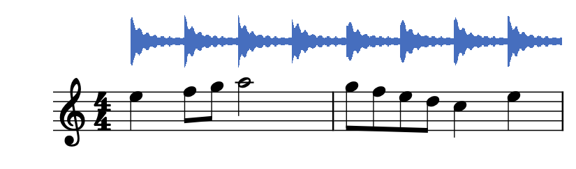

# Time Grid

A MuseScore Studio extension that puts your notes on an even time grid, so a waveform or spectrogram of the recording lines up with the music.

A note twice as long gets twice the room, and every beat is the same distance apart, across barlines too.

## Install

You need MuseScore Studio 4.7 or newer.

1. Download `time_grid-<version>.zip` from the [Releases](../../releases) page and unzip it.
   You get a folder called `time_grid`.
2. Open MuseScore's extensions folder:
   - **macOS:** in Finder, choose Go > Go to Folder, paste `~/Library/Application Support/MuseScore/MuseScore4/extensions` and press Return.
   - **Windows:** paste `%LOCALAPPDATA%\MuseScore\MuseScore4\extensions` into the File Explorer address bar and press Enter.
   - **Linux:** open `~/.local/share/MuseScore/MuseScore4/extensions`.

   If the `extensions` folder does not exist yet, create it.
3. Move the `time_grid` folder into it.
4. Restart MuseScore, go to Home > Plugins and enable **Time Grid**.

To update, replace the `time_grid` folder with the new one and restart MuseScore.

## Use

Open it from Plugins > Time Grid.
The window stays open and follows what you select in the score.
The **?** button shows a short help.

- **Make linear:** select some bars or whole systems and press it.
- **Keep bars on their line:** when a line is too dense for even spacing, its last bars normally move to the next line.
  Check this to keep them; notes and signatures may then overlap.
- **Reset** undoes the selection, **Reset all** puts the whole score back as it was.

The table shows, for each line, when it starts and ends and where (From and To, in millimetres from the left page edge).

### Waveforms and spectrograms

1. Drag the picture file onto the bar where it should start.
2. Click the picture.
3. Press **Align to whole system**, or pick a number of bars and press **Align to bars**.

The picture is scaled to run exactly from the first note to the end of those bars, just above the staff.
Space the bars first: after changing the spacing, align the picture again.
If the picture runs into the line above, add space above the staff, for example with a staff spacer.

### Good to know

- Make linear sets the score's spacing ratio (Format > Style) to 2 and locks systems, so the rest of the score keeps its layout.
  Reset all restores both.
- Times ignore repeats.
- On a long score, work a few systems at a time: the whole score is laid out again on every pass.
- The window speaks English and Polish, following MuseScore's language.

## For developers

- `./install.sh` builds the extension into MuseScore's extensions folder (macOS).
  The files in `time_grid/src` are joined into one `core.js`.
- `node --test tests/*.test.js` runs the unit tests, `tests/run.sh` the end-to-end tests in the real MuseScore.
- `tools/release.sh` builds the release zip, `tools/make_figure.py` the help figure.
- How it works is described at the top of each file in `time_grid/src`, starting with `linearize.js`.
- Translations live in `time_grid/src/i18n.js`; the unit tests report every missing text.

## License

GPL-3.0, like MuseScore itself: see [LICENSE](LICENSE).
